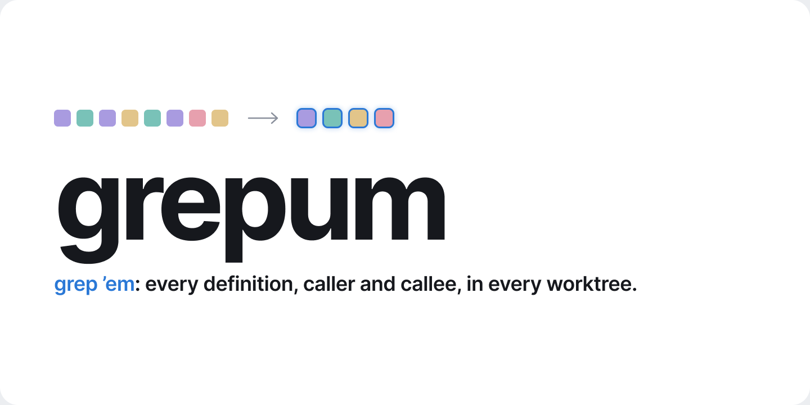
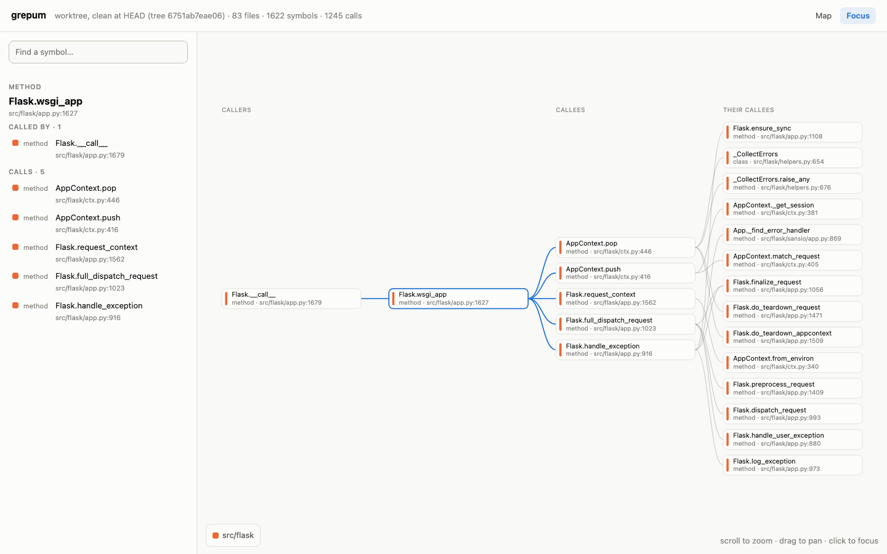
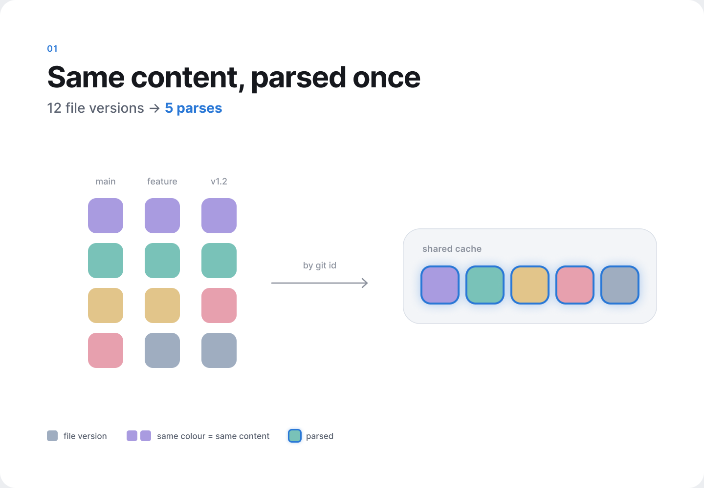
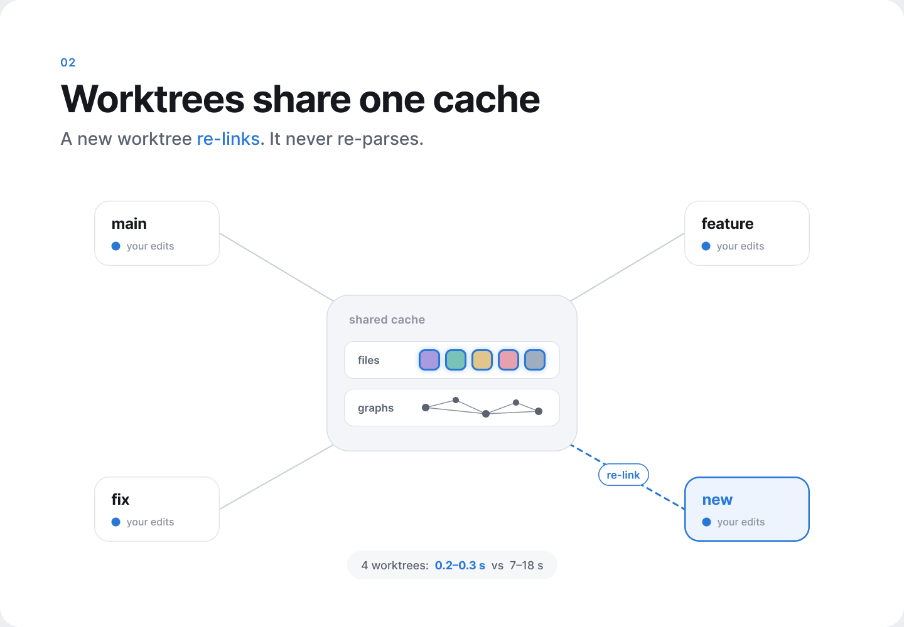
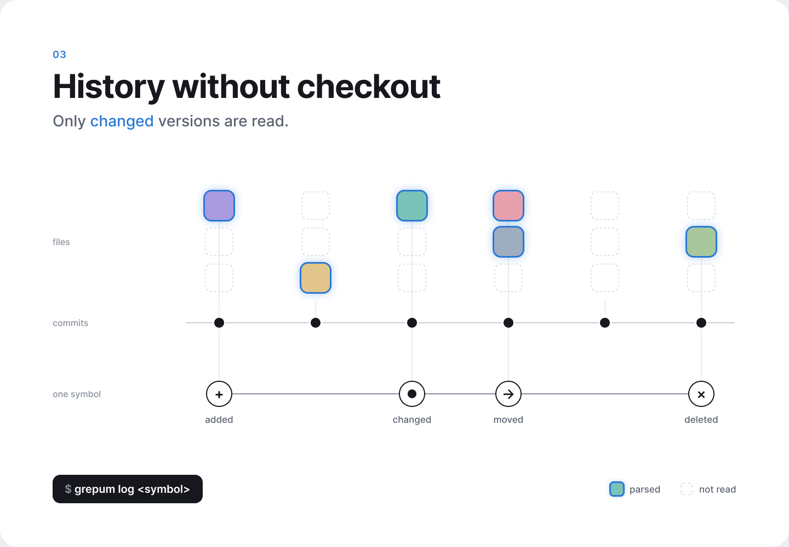
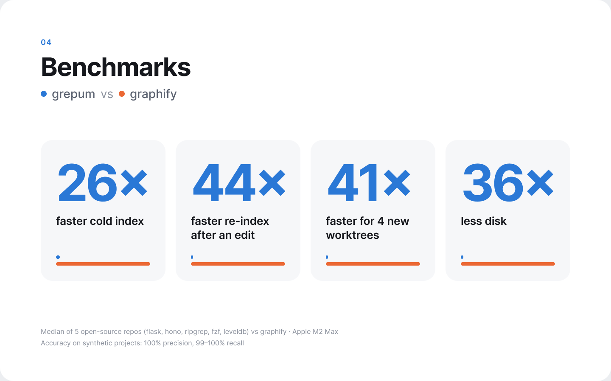
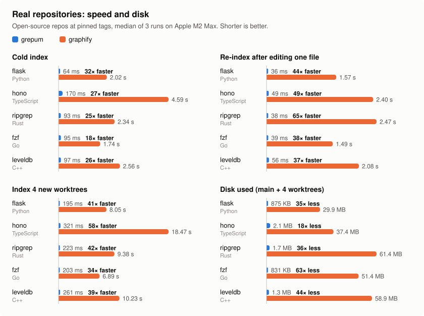
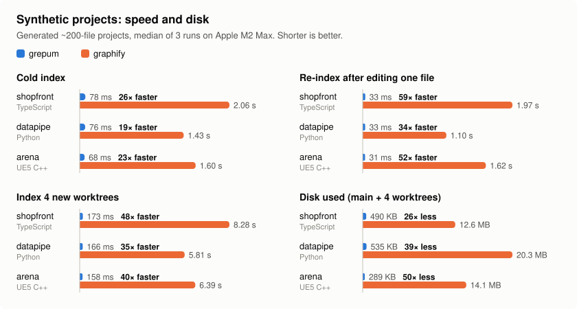
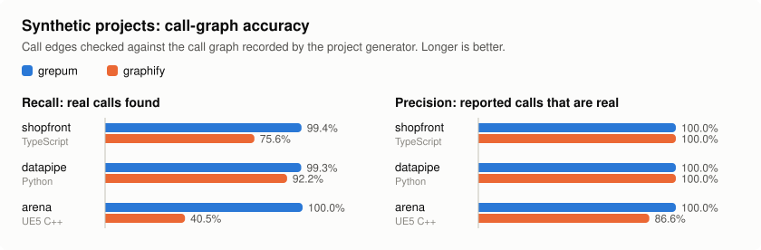

# grepum



A code graph woven into git. Definitions, calls, imports and inheritance for
Python, TypeScript/JavaScript, Rust, Go and C/C++ (with Unreal Engine 5
awareness), cached by **git object id** inside
your repository's own `.git` directory, so every worktree, branch and commit
shares the work.

## Install

```
curl -fsSL https://raw.githubusercontent.com/grepum/grepum/main/install.sh | sh
```

This downloads a prebuilt binary (macOS, Linux and Windows; x86_64 and arm64)
into `~/.local/bin` and asks whether to set up Claude Code. Flags go after
`sh -s --`:

```
... | sh -s -- --claude user      # + Claude Code skill, code-navigator agent and session hook for all projects
... | sh -s -- --claude project   # ...or only for the repo you run it in (commit .claude/ to share)
... | sh -s -- --git-hooks        # + keep the graph warm after commits/checkouts in the current repo
... | sh -s -- --uninstall        # remove all of the above
```

Other ways to get the binary:

```
grepum upgrade                                    # update an installed grepum to the latest release
./install.sh --from-source                        # from a checkout (needs Rust)
powershell -c "irm https://github.com/grepum/grepum/releases/latest/download/grepum-installer.ps1 | iex"   # Windows
```

The integrations can also be managed directly: `grepum install claude
[--scope user|project] [--dry-run]`, `grepum uninstall claude`,
`grepum install git-hooks`.

## Usage

```
grepum index                     # graph of this worktree (incl. uncommitted edits)
grepum find order service        # ranked symbol search
grepum callers OrderService.get  # who calls it (--depth N for transitive)
grepum callees run_order
grepum context "checkout payment"   # compact neighbourhood, sized for an agent prompt
grepum diff main                 # symbols + call edges added/removed vs main
grepum --rev v1.2 callers save   # query any commit, no checkout needed
grepum log Flask.wsgi_app         # commits that added/modified/moved/removed it, across files
grepum find json encoder --history   # also finds deleted symbols + the commit to `git show`
grepum summary                   # short orientation for an agent's context
grepum html --open               # explore the graph in your browser (one offline HTML file)
grepum html Flask.wsgi_app       # ...starting at one symbol's callers and callees
grepum hooks install             # keep the graph warm after commit/checkout/merge/rebase
```

Any command takes `--json`.

## Explore it in a browser

`grepum html` writes one self-contained HTML file: the graph data plus a small
viewer, with no network access and no external scripts, so it works offline and
can be attached to an issue. **Map** shows folders sized by symbol count with
the call traffic between them; **Focus** shows a symbol with its callers on the
left and callees on the right, two steps each way. Search, click to refocus,
scroll to zoom; links like `graph.html#focus=Flask.wsgi_app` reopen a view.



## How it works





```
<git-common-dir>/grepum/<ver>/blobs/ab/<oid>.<lang>   L1: facts per file content   (shared by all worktrees)
<git-common-dir>/grepum/<ver>/trees/<tree>.graph      L2: resolved graph per tree  (shared)
<git-dir>/grepum/<ver>/overlay.graph                  L3: this worktree's dirty state (private)
```

1. **L1, facts by blob.** Each file is parsed with tree-sitter into definitions,
   references, imports and type bindings. Facts depend only on content, so
   they're keyed by the blob id git already computed. A file that's identical
   in ten worktrees or a hundred commits is parsed once.
2. **L2, graph by tree.** Cross-file resolution (imports, re-exports, receiver
   types, return types, inheritance) produces the linked graph, keyed by tree
   id. Any commit with the same content reuses it; any commit can be indexed
   without being checked out.
3. **L3, overlay.** `git status` (via the index's stat cache) finds edited
   files; only those are hashed and parsed, then the graph is re-linked. The
   overlay is keyed by the exact dirty state and lives in the worktree's
   private git dir.



**History.** `git log --raw` lists the old and new blob ids of every file a
commit touched, without reading any contents. Each definition in L1 carries a
whitespace-insensitive fingerprint of its body, so comparing a commit's
before/after facts gives added, modified, moved and removed symbols. Old
versions mostly share blobs, so only never-seen versions are parsed, and each
commit's result is cached by commit id. On flask's 2,283 first-parent commits
the first `grepum log` takes ~1.2 s and later ones ~60 ms, following
`Flask.wsgi_app` back to its 2010 origin in `flask.py` across two file moves.

Resolution is conservative. Edges are `exact` when proven by scope, imports
or types, `inferred` when the name is globally unique, and dropped when
ambiguous. Receivers whose type is known to be external (`app: Express`,
`rows: list`) are never linked to a same-named local method.

## C++ and Unreal Engine

- Header prototypes and out-of-line definitions (`void AFoo::Bar()`) are
  linked: calls land on the definition, `#include "x/y.h"` resolves by
  path suffix.
- Calls inside methods resolve through the class and its bases (implicit
  `this`), `Super::` goes to the parent class, `ns::Func()` to namespaces.
- Unreal macros (`ARENA_API`, `UCLASS(...)`, `UFUNCTION(...)`,
  `GENERATED_BODY()`, `DECLARE_*_DELEGATE*`) are blanked before parsing, with
  line numbers preserved, and reflection specifiers are kept as tags.
- `Server`/`Client`/`NetMulticast` RPCs and `BlueprintNativeEvent`s route to
  `<Name>_Implementation`. `BindAction`/`AddDynamic`/`SetTimer` with
  `&AFoo::Bar` count as calls. `Cast<T>`, `NewObject<T>`, `SpawnActor<T>`,
  `GetSubsystem<T>`, `TObjectPtr<T>` and similar wrappers type their results.

## Claude Code

`grepum install claude` installs a skill, a read-only `code-navigator`
subagent and a session-start hook. Your existing `settings.json` is merged,
not replaced, and `uninstall` restores it. The same files are packaged as a
plugin in `integrations/claude-code/`; see its README.

## Benchmarks



grepum against [graphify](https://github.com/Graphify-Labs/graphify) (`graphify update .`,
AST only) through the same worktree workflow, on two sets of projects.

### Real repositories

Five open-source repos, one per language, cloned at a pinned tag:
[flask](https://github.com/pallets/flask) 3.1.3,
[hono](https://github.com/honojs/hono) v4.13.19,
[ripgrep](https://github.com/BurntSushi/ripgrep) 15.2.0,
[fzf](https://github.com/junegunn/fzf) v0.75.0 and
[leveldb](https://github.com/google/leveldb) 1.23.

<picture>
  <source media="(prefers-color-scheme: dark)" srcset="benchmark/charts/real-speed-dark.svg">
  
</picture>

There is no ground truth for real code, so these runs measure speed and disk
only. Call-edge counts are in the results table.

### Synthetic projects with a known call graph

Three generated projects (TypeScript, Python, Unreal Engine 5 C++) where every
call is recorded, so accuracy can be scored.

<picture>
  <source media="(prefers-color-scheme: dark)" srcset="benchmark/charts/synthetic-speed-dark.svg">
  
</picture>

<picture>
  <source media="(prefers-color-scheme: dark)" srcset="benchmark/charts/synthetic-accuracy-dark.svg">
  
</picture>

Caveat: the same author wrote the generator and the resolver, and the
resolver was tuned against these projects. They use common idioms, but treat
the accuracy numbers as a regression suite, not proof of accuracy on real code.

### Running it

```
cargo build --release
python3 benchmark/generate.py   # writes the synthetic projects + ground truth (not committed)
python3 benchmark/bench.py --graphify $(which graphify)   # --set synthetic|real|all
python3 benchmark/charts.py     # redraws the charts above
```

Real repos are shallow-cloned into `benchmark/repos/` (gitignored) on first
use; the list and tags are in [`benchmark/real_repos.json`](benchmark/real_repos.json).
Full numbers, including warm re-index, query latency and edge counts, are in
[`benchmark/results/`](benchmark/results/), and every run is kept in
[`benchmark/results/runs/`](benchmark/results/runs/) with the machine, commit
and tool versions.

## Status

MVP. Known gaps and planned work are in [ROADMAP.md](ROADMAP.md).

## Releasing

Bump `version` in `Cargo.toml`, commit, then tag and push:

```
git tag v0.2.0 && git push origin v0.2.0
```

Every release first runs the dependency audit ([`deny.toml`](deny.toml), via
`cargo deny check`): RustSec advisories, licenses compatible with MIT, banned
crates and unknown sources. It also enforces a 5-day dependency cooldown: no
crates.io version published less than 5 days ago may be in `Cargo.lock`
([`.github/scripts/crate-age.py`](.github/scripts/crate-age.py)), so a
compromised release has time to be caught and yanked first. Cargo 1.100+ applies
the same window when resolving (`registry.global-min-publish-age` in
[`.cargo/config.toml`](.cargo/config.toml)), so `cargo update` only picks
versions that will pass. If any check fails, nothing is built or published.
The same audit runs on dependency changes and weekly.

The `Release` workflow (generated by [dist](https://opensource.axo.dev/cargo-dist/);
regenerate with `dist generate` after editing `dist-workspace.toml`) builds all
targets and publishes a GitHub Release with the binaries and installers.

## License

MIT
