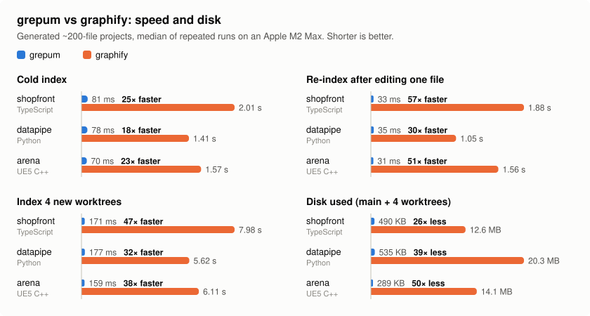

# grepum

*grep 'em: every definition, caller and callee, in every worktree.*

A code graph woven into git. Definitions, calls, imports and inheritance for
Python, TypeScript/JavaScript, Rust, Go and C/C++ (with Unreal Engine 5
awareness), cached by **git object id** inside
your repository's own `.git` directory, so every worktree, branch and commit
shares the work.

## Install

```
curl -fsSL https://raw.githubusercontent.com/grepum/grepum/main/install.sh | sh
```

This downloads a prebuilt binary (macOS, Linux and Windows; x86_64 and arm64)
into `~/.local/bin` and asks whether to set up Claude Code. Flags go after
`sh -s --`:

```
... | sh -s -- --claude user      # + Claude Code skill, code-navigator agent and session hook for all projects
... | sh -s -- --claude project   # ...or only for the repo you run it in (commit .claude/ to share)
... | sh -s -- --git-hooks        # + keep the graph warm after commits/checkouts in the current repo
... | sh -s -- --uninstall        # remove all of the above
```

Other ways to get the binary:

```
grepum upgrade                                    # update an installed grepum to the latest release
cargo install grepum --locked                     # from crates.io (needs Rust)
./install.sh --from-source                        # from a checkout (needs Rust)
powershell -c "irm https://github.com/grepum/grepum/releases/latest/download/grepum-installer.ps1 | iex"   # Windows
```

The integrations can also be managed directly: `grepum install claude
[--scope user|project] [--dry-run]`, `grepum uninstall claude`,
`grepum install git-hooks`.

## Usage

```
grepum index                     # graph of this worktree (incl. uncommitted edits)
grepum find order service        # ranked symbol search
grepum callers OrderService.get  # who calls it (--depth N for transitive)
grepum callees run_order
grepum context "checkout payment"   # compact neighbourhood, sized for an agent prompt
grepum diff main                 # symbols + call edges added/removed vs main
grepum --rev v1.2 callers save   # query any commit, no checkout needed
grepum summary                   # short orientation for an agent's context
grepum hooks install             # keep the graph warm after commit/checkout/merge/rebase
```

Any command takes `--json`.

## How it works

```
<git-common-dir>/grepum/<ver>/blobs/ab/<oid>.<lang>   L1: facts per file content   (shared by all worktrees)
<git-common-dir>/grepum/<ver>/trees/<tree>.graph      L2: resolved graph per tree  (shared)
<git-dir>/grepum/<ver>/overlay.graph                  L3: this worktree's dirty state (private)
```

1. **L1, facts by blob.** Each file is parsed with tree-sitter into definitions,
   references, imports and type bindings. Facts depend only on content, so
   they're keyed by the blob id git already computed. A file that's identical
   in ten worktrees or a hundred commits is parsed once.
2. **L2, graph by tree.** Cross-file resolution (imports, re-exports, receiver
   types, return types, inheritance) produces the linked graph, keyed by tree
   id. Any commit with the same content reuses it; any commit can be indexed
   without being checked out.
3. **L3, overlay.** `git status` (via the index's stat cache) finds edited
   files; only those are hashed and parsed, then the graph is re-linked. The
   overlay is keyed by the exact dirty state and lives in the worktree's
   private git dir.

Resolution is conservative. Edges are `exact` when proven by scope, imports
or types, `inferred` when the name is globally unique, and dropped when
ambiguous. Receivers whose type is known to be external (`app: Express`,
`rows: list`) are never linked to a same-named local method.

## C++ and Unreal Engine

- Header prototypes and out-of-line definitions (`void AFoo::Bar()`) are
  linked: calls land on the definition, `#include "x/y.h"` resolves by
  path suffix.
- Calls inside methods resolve through the class and its bases (implicit
  `this`), `Super::` goes to the parent class, `ns::Func()` to namespaces.
- Unreal macros (`ARENA_API`, `UCLASS(...)`, `UFUNCTION(...)`,
  `GENERATED_BODY()`, `DECLARE_*_DELEGATE*`) are blanked before parsing, with
  line numbers preserved, and reflection specifiers are kept as tags.
- `Server`/`Client`/`NetMulticast` RPCs and `BlueprintNativeEvent`s route to
  `<Name>_Implementation`. `BindAction`/`AddDynamic`/`SetTimer` with
  `&AFoo::Bar` count as calls. `Cast<T>`, `NewObject<T>`, `SpawnActor<T>`,
  `GetSubsystem<T>`, `TObjectPtr<T>` and similar wrappers type their results.

## Claude Code

`grepum install claude` installs a skill, a read-only `code-navigator`
subagent and a session-start hook. Your existing `settings.json` is merged,
not replaced, and `uninstall` restores it. The same files are packaged as a
plugin in `integrations/claude-code/`; see its README.

## Benchmarks

<picture>
  <source media="(prefers-color-scheme: dark)" srcset="benchmark/charts/bench-speed-dark.svg">
  
</picture>

<picture>
  <source media="(prefers-color-scheme: dark)" srcset="benchmark/charts/bench-accuracy-dark.svg">
  
</picture>

`benchmark/` has a generator for three fake projects (TypeScript, Python,
Unreal Engine 5 C++) with a known call graph, and
a harness that runs grepum and [graphify](https://github.com/Graphify-Labs/graphify)
through the same worktree workflow:

```
cargo build --release
python3 benchmark/generate.py   # writes the projects + ground truth (not committed)
python3 benchmark/bench.py --graphify $(which graphify)
python3 benchmark/charts.py     # redraws the charts above from the results
```

Full numbers, including warm re-index, query latency and hard cases, are in
[`benchmark/results/latest.md`](benchmark/results/latest.md); every run is
also kept in [`benchmark/results/runs/`](benchmark/results/runs/) with the
machine, commit and tool versions.

Caveat: the same author wrote the generator and the resolver, and the
resolver was tuned against these projects. They use common idioms, but treat
the accuracy numbers as a regression suite, not proof of accuracy on real code.

## Status

MVP. Not yet: call-site inference for untyped parameters, C++ overload
resolution by argument types, templates beyond the known UE helpers, `export default`
tracking, tsconfig `paths`, Python decorators as call edges, packing L1 into a
single file for very large repos, sharing L2 through `refs/notes` / a ref so CI
can publish graphs.

## Releasing

Bump `version` in `Cargo.toml`, commit, then tag and push:

```
git tag v0.2.0 && git push origin v0.2.0
```

The `Release` workflow (generated by [dist](https://opensource.axo.dev/cargo-dist/);
regenerate with `dist generate` after editing `dist-workspace.toml`) builds all
targets and publishes a GitHub Release with the binaries and installers.
Publish the crate with `cargo publish`.

## License

MIT
